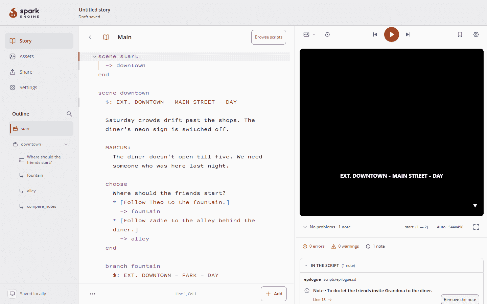
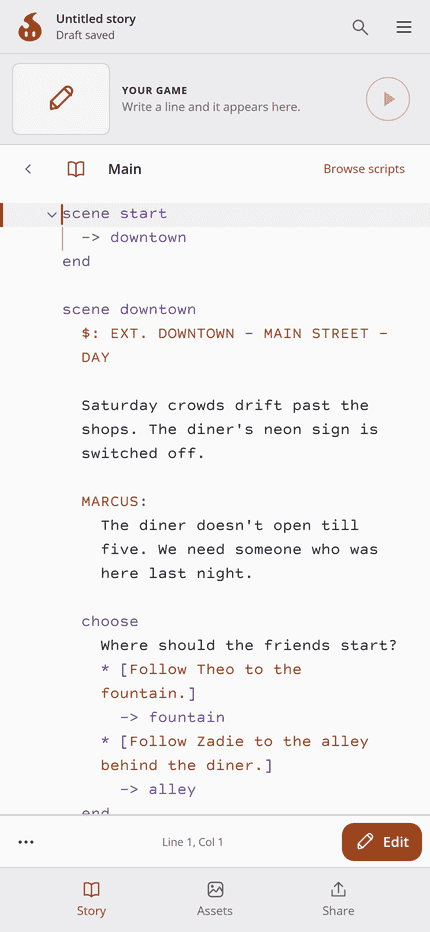
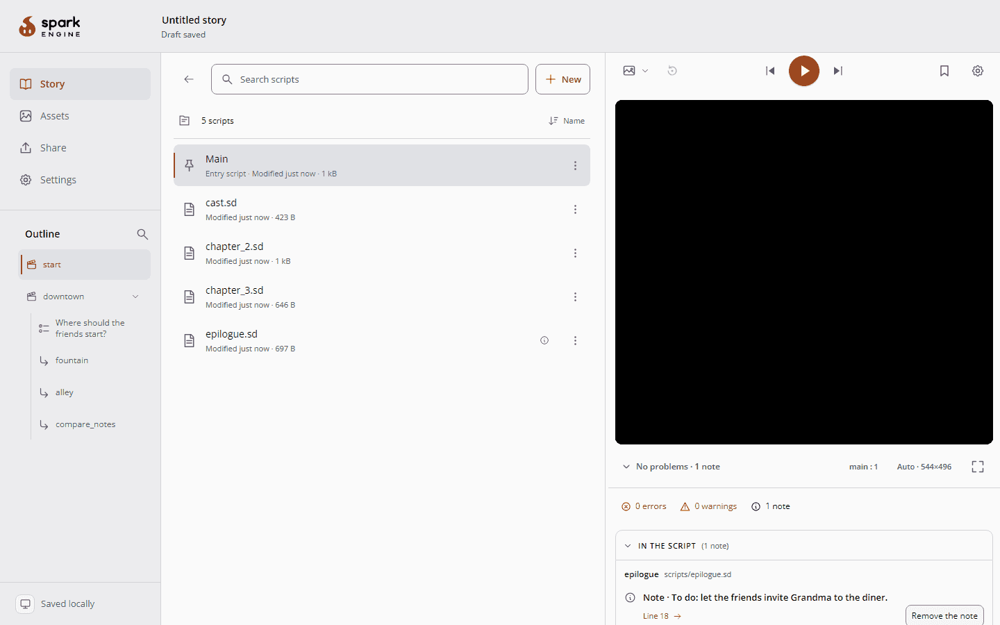
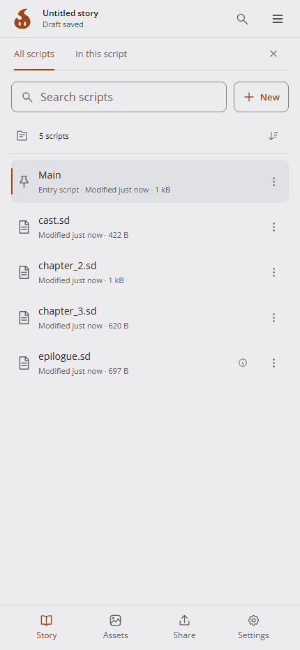
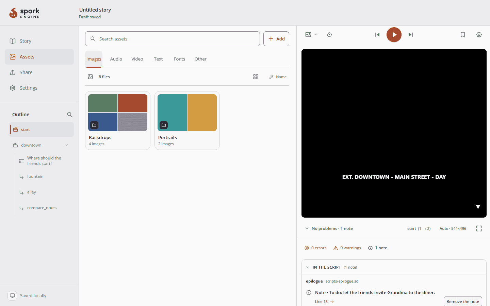
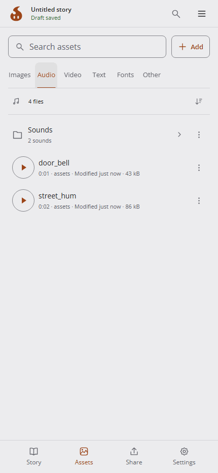
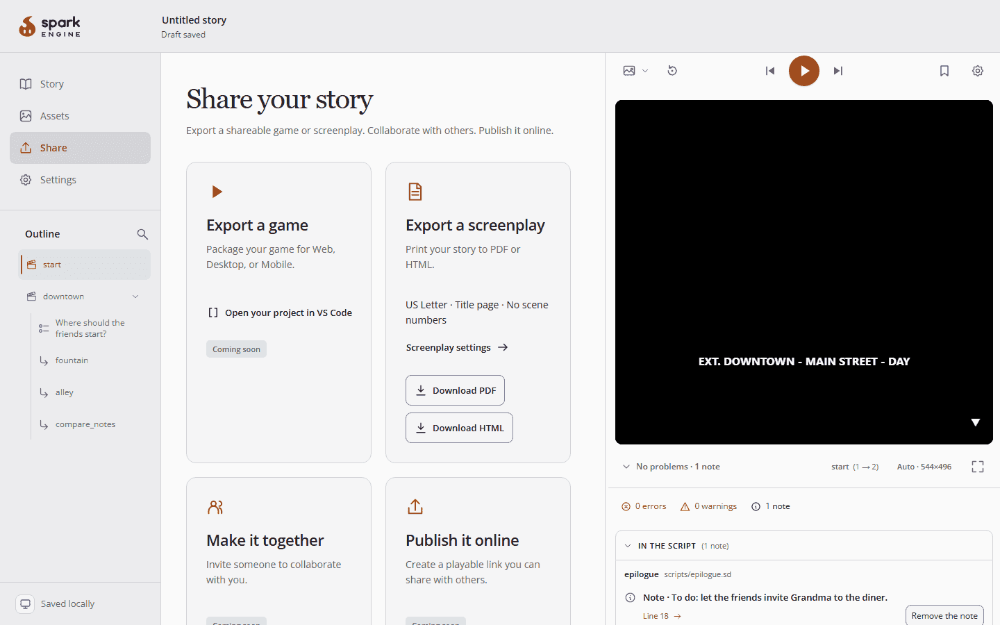
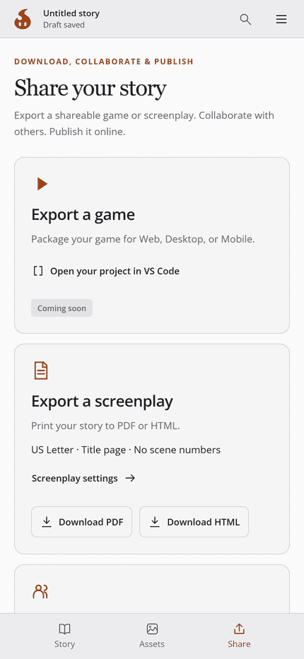
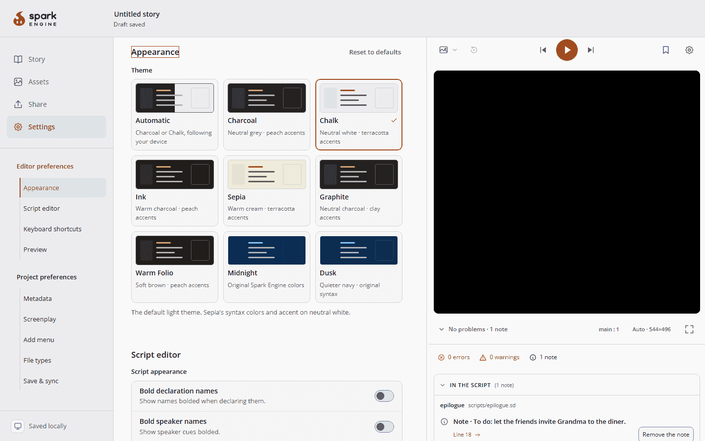
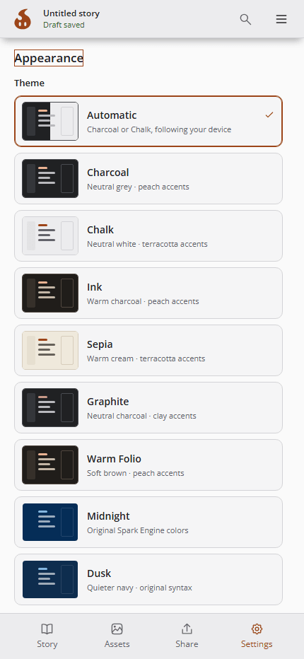

# The Web Editor

The web editor is where you write, play and share your story in the browser, on a
computer or on a phone. It has five places, and you can always get back to your
script from any of them:

- **Story**: your script, with the game playing beside it.
- **Scripts**: every script in your project.
- **Assets**: your art, sounds, music, videos and fonts.
- **Share**: exporting your game and your screenplay.
- **Settings**: how the editor looks and behaves, and your project's own preferences.

Story, Assets, Share and Settings are in the rail down the left side on a computer, and
in the bar along the bottom on a phone; Scripts opens from Story. To leave Settings,
pick Story, Assets or Share.

The pictures below show a small sample project at two sizes: a computer screen 1440
pixels wide and a phone 430 pixels wide.

## Story

Story is where you write. The script fills the middle of the screen, and its name is
at the top, with **Browse scripts** to open the Scripts page. The arrow at the left of
the name shows or hides line numbers.

- **Outline** lists the scenes, branches and choices of the script you are in. Pick
  one to jump to it. Its search button finds words across your scripts, with
  switches for matching case, whole words and patterns.
- **Add** opens the Add menu, which writes a scene, a branch, a choice menu, a
  character, a line of dialogue, a backdrop, a portrait, a sound or a music cue for
  you. The art and sound pickers show the files in the folders you chose for them in
  Settings, Add menu.
- **The preview** plays your game. Play starts it from the line you are on, and the
  buttons beside Play step back and forward through it. The preview can also show
  your story as a screenplay.
- **Problems** under the preview lists every error, warning and note in your
  project, grouped by script. Pick one to go to its line.

### On a phone

A phone shows one thing at a time. Your script opens for reading, so you can scroll
through it without the keyboard popping up; press **Edit** to start writing, and the
bar above the keyboard gives you Indent, Dedent, Format and Add. The **Your game**
strip at the top shows the line you are on in the game; its Play button opens the
game and starts it from that line.

## Scripts

Scripts lists every script in your project. **Main** is pinned at the top: it is
where your story starts. Use **New** to add a script or a folder, the search box to find
one, and the sort button to order them by name, date, size, how often they are used or the order
the story reaches them. Each script's menu selects, renames, moves, duplicates,
downloads or deletes it, except Main's, which only duplicates or downloads it, since your story
always starts there; a script with a problem shows an
icon beside its name. **Back to story**, the close button at the end of the tabs or the back
arrow before the search box where there are no tabs, returns to the script you were writing.

On a phone, the **In this script** tab is the outline of the script you were
writing.

## Assets

Assets holds everything your story shows or plays. The tabs sort your files by kind:
Images, Audio, Video, Text, Fonts and Other. Images show as tiles and sounds as rows you can play.
**Add** brings in files from your device, adds a link to a file online or makes a
new folder, and you can drop files onto the page. Keep them in folders however you
like. Every tile and row has a menu button (⋮), which opens a menu on a computer and
a sheet on a phone:

- A file's menu has **Select**, **Rename**, **Move…** and **Delete**, and a picture with
  variants also has **Variants**.
- A folder's menu has **Open**, **Select**, **Upload here…**, **New folder inside…**,
  **Rename**, **Move…** and **Delete**.

Opening a file shows its details beside the list on a computer, and as a sheet over
the page on a phone, with **Back to the collection** to return. The details give its
type and size (and a sound's length), where it is and where your story uses it. A
picture can be zoomed or viewed full size, and a sound played, restarted or looped.
**Replace…** and **Download** are under the details, and the details' own menu
button has **Rename**, **Move…**, **Download** and **Delete**.

## Share

Share is where your story leaves the editor. **Export a screenplay** downloads your
story as a PDF or a web page, laid out the way Settings, Screenplay says. Packaging a game is
coming soon; until then, **Open your project in VS Code** takes it to the VS Code
extension. Working together and publishing online are on their way too.

## Settings

Settings has two halves. **Editor preferences** belong to you and this browser:

- **Appearance**: the theme, and how the editor's surfaces and the script's colours
  look. Automatic follows your device's light or dark setting.
- **Script editor**: what the script shows (bold names, tinted dialogue, italic
  comments, indentation guides) and how it helps (suggestions as you type, renaming linked
  files).
- **Keyboard shortcuts**: which keys do what.
- **Preview**: the screenplay paper, and whether the game follows your caret, plays
  each line's beat and its sound, and keeps idle animations moving.

**Project preferences** travel with your project:

- **Metadata**: the title and other details, written at the top of Main.
- **Screenplay**: the paper, the title page and how the screenplay is laid out.
- **Add menu**: which folder each Add menu picker looks in for backdrops, portraits,
  music and sounds.
- **File types**: which files count as scripts and which as each kind of asset.
- **Save & sync**: your project is saved to this device as you write. Download a
  backup as a .zip, import a project from one, or connect Google Drive to back it up
  and sync it online. Clearing your browser's site data deletes what is saved on the
  device, so keep a backup.
